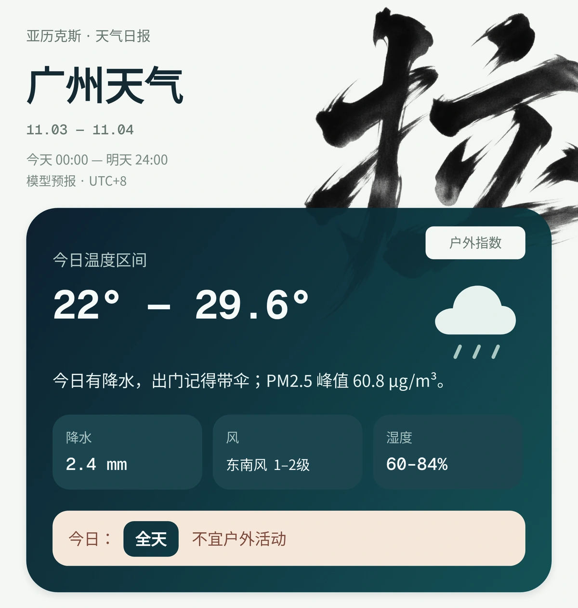
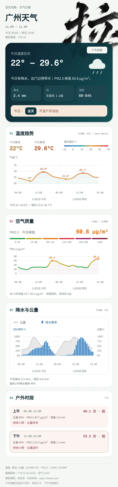
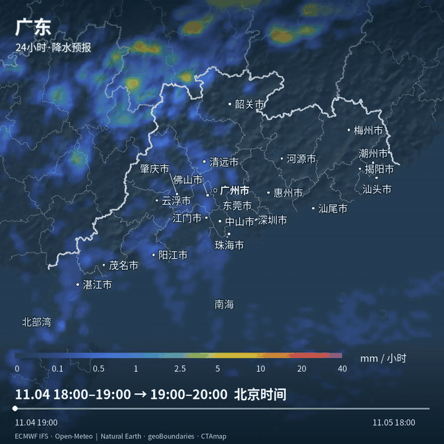
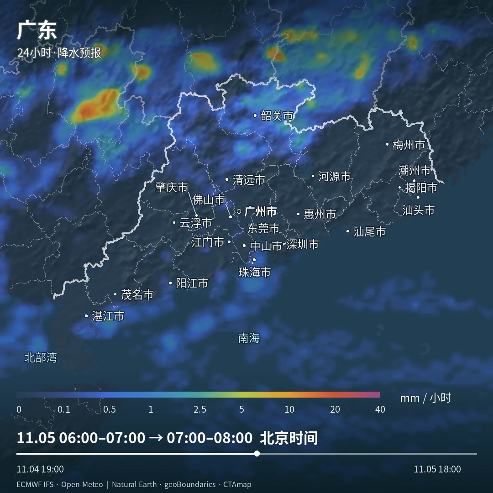
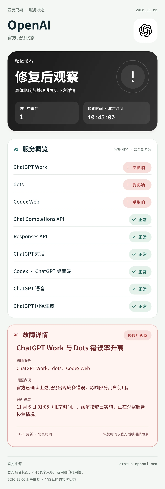
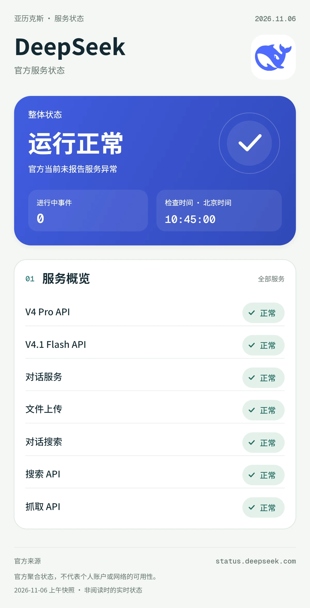
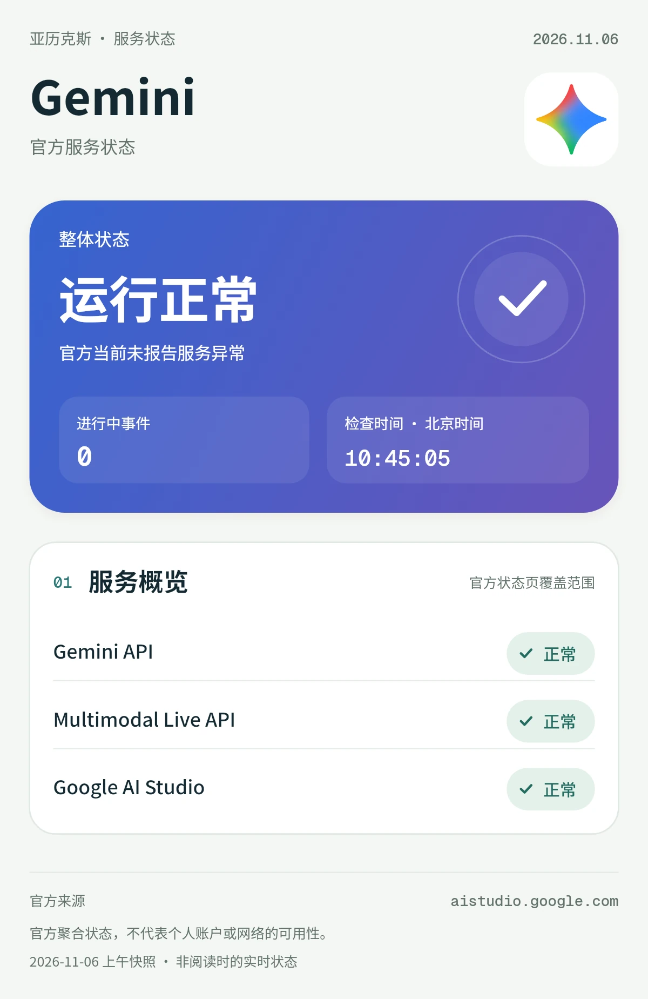
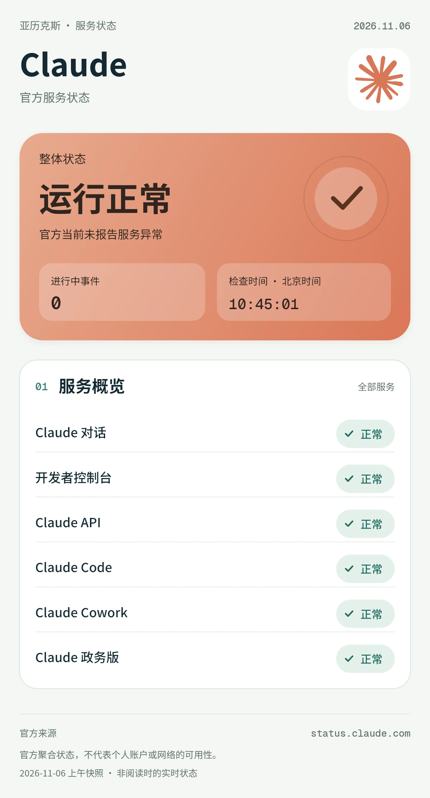
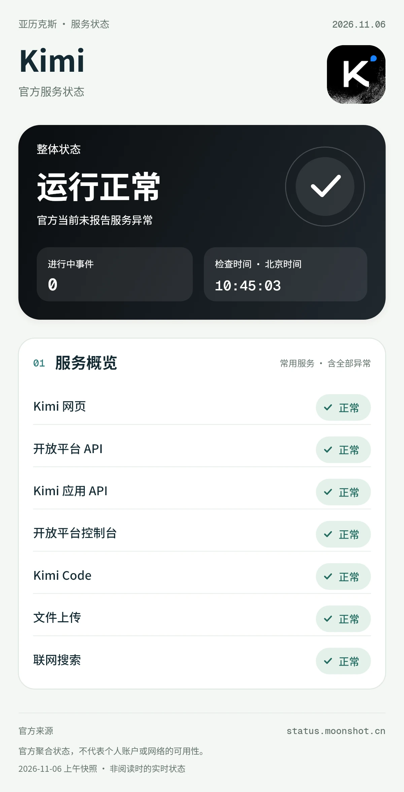
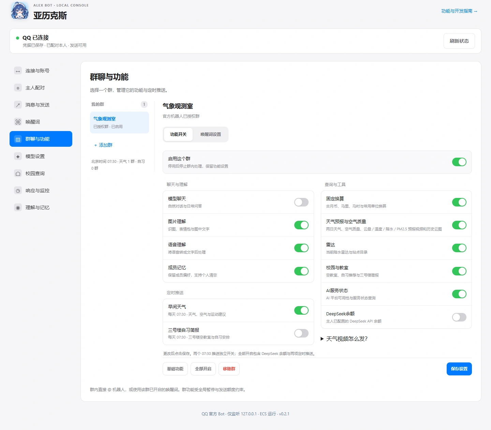

<p align="center">
  
</p>
<h1 align="center">亚历克斯 QQ Bot</h1>
<p align="center">问天气、看雷达、查教室。支持自然语言，也支持直接发指令。</p>
<p align="center">QQ 官方 Bot · Python LangChain · 独立群权限 · 图像与视频回复</p>

## 能做什么

- **天气与户外**：两日天气简报，温度、降水、云量、PM2.5，以及分上午、下午计算的户外指数。
- **动态气象**：云量、温度、降水、PM2.5 的 24 / 48 小时预报视频；历史云图回看近 6 小时观测。支持城市、省区、大区和部分景点、山峰、村庄、徒步路线。
- **实用查询**：全球降水雷达、五家 AI 服务状态、学院路空教室与三号楼自习简报、固定单位换算。
- **按群管理**：快速匹配群聊、独立功能开关、全局唤醒词与各群开关。普通聊天可以关闭，仍能用自然语言调用已开放的工具。
- **定时与帮助**：早间天气、三号楼自习简报各自订阅，每天北京时间 07:30 推送；`/help` 按当前聊天的功能和唤醒词生成帮助图。

## 看看效果

以下是程序实际渲染的样例。天气和服务状态保留采集日期，代表当时结果；控制台使用演示群名与配置。

### 两日天气与户外指数

将天气摘要、空气质量和适合户外活动的时段放在一起，下方继续展示逐小时曲线。户外指数使用项目自定义规则。



<details>
<summary>展开查看完整天气图与逐小时曲线</summary>



</details>

### 24 / 48 小时动态预报

在 QQ 中直接播放视频，地图上显示地名、预报类型、色阶和时间轴。云量、温度、降水优先使用 ECMWF IFS；PM2.5 使用 ECMWF/CAMS。预报云图与历史卫星观测分开查询。



<details>
<summary>展开查看清晰原帧</summary>



</details>

### AI 服务状态

支持 OpenAI、DeepSeek、Gemini、Claude、Kimi。有故障时，红色信息区列出受影响服务、事件说明和最新修复进展。


以下为 **2026-11-06 上午的官方状态快照**。OpenAI 展示当天的真实故障：ChatGPT Work、Dots 与 Codex Web 受影响，已采取缓解措施、正在观察恢复；[官方事件记录](https://status.openai.com/incidents/01M6P50GPP1V98EF8MJ9SH393R)。图片不代表阅读时的实时状态。

<details>
<summary>展开 OpenAI：服务异常与处理进展</summary>



</details>

<details>
<summary>展开 DeepSeek 完整状态图</summary>



</details>

<details>
<summary>展开 Gemini 完整状态图</summary>



</details>

<details>
<summary>展开 Claude 完整状态图</summary>



</details>

<details>
<summary>展开 Kimi 完整状态图</summary>



</details>

### 控制台

选择群聊即可修改功能与定时推送；在任意页面增删改唤醒词都会同步到全局，各群独立选择启用哪些词。



<details>
<summary>展开查看完整控制台</summary>


</details>

<details>
<summary>展开查看自动生成的帮助图</summary>

帮助内容随当前聊天权限更新，展示实际可用的指令和唤醒词。


</details>

## 怎么问

主人私聊直接发送；群聊先 **@机器人**，或使用已启用的**唤醒词 + 空格**。例如：

```text
大肥鱼 北京明天要带伞吗？
小瘦鱼 看看新疆未来两天的动态温度
梁圣 外面打雷了，看看成都的雷达图
```

固定指令直接调用工具，无需 DeepSeek 理解自然语言。下表省略群聊的 @ / 唤醒词：

| 想做什么 | 指令示例 |
| --- | --- |
| 当前聊天的帮助图 | `/help` |
| 两日天气 | `发 天气 广州` |
| PM2.5 曲线 | `发 PM2.5 北京` |
| 雷达图 | `发 雷达 成都` |
| 云量预报视频 | `发 云图 南京` |
| 历史卫星云图 | `发 历史云图 南京` |
| 48 小时云量预报 | `发 动态云图48h 华北` |
| 48 小时温度预报 | `发 48h动态温度 新疆` |
| 48 小时 PM2.5 预报 | `发 48h动态pm2.5 北京` |
| 降水预报视频 | `发 动态降水 广东` |
| 服务状态 | `查 OpenAI 状态`，也可换成其他四家 |
| 自习教室 | `发 三号楼空教室情况` |
| 固定换算 | `1马里换公里` |

各群可用功能以当次 `/help` 为准。图片和视频查询成功后直接发成品，无需附加文字。

## 实现与运行

**Node.js** 负责 QQ 官方 SDK、授权、唤醒词、消息队列、发送与控制台；**Python LangChain** 负责受限工具和自然语言路由。固定指令、自然语言和定时任务复用业务实现。图片与视频按队列处理，数据下载使用受限并发与缓存。

响应监控可查看排队、数据获取、解码、绘图、H.264 编码和 QQ 投递耗时。启用 LangSmith 后，trace 包含触发消息原文、工具参数和错误信息。

正式实例运行在 ECS，通过 SSH 隧道访问本机控制台。当前仅使用 **QQ 官方 Bot**；OneBot 已退役。部署会保留运行状态，执行备份、回归、地图资产校验与进程核验。

[展示图与素材来源](docs/public-assets.md)
